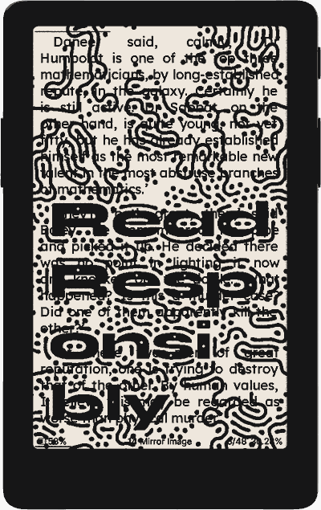
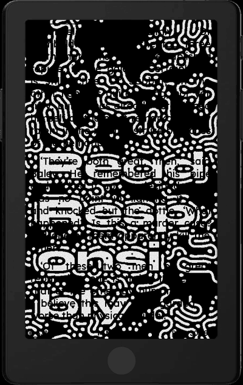
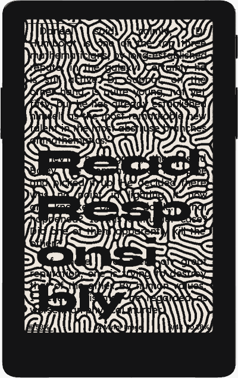
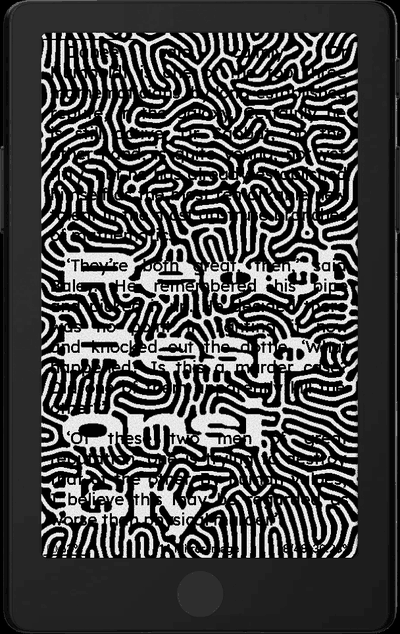
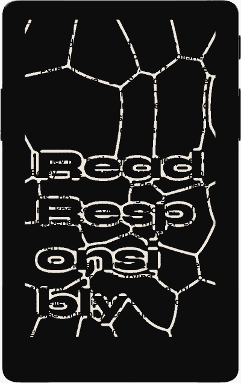

<h1 align="center">
  <picture>
    <source media="(prefers-color-scheme: dark)" srcset="./docs/images/logo/logo-white.png" />
    
  </picture>
</h1>

<p align="center">
  A personal fork of <a href="https://github.com/uxjulia/CrossInk">CrossInk</a> for the <b>Xteink X4 Pro</b>:
  reading-habit stats, Indic books, and sleep screens that change as you read and charge.
</p>

<table>
  <tr>
    <td align="center">
      <br/>
      <sub>Reading Rhythm</sub>
    </td>
    <td align="center">
      <br/>
      <sub>Kannada book</sub>
    </td>
    <td align="center">
      <br/>
      <sub>Glass House scene</sub>
    </td>
  </tr>
</table>

Everything else is stock CrossInk: the same fonts, themes, reader features, settings and SD card layout. Your existing stats files are never changed, so you can flash stock CrossInk back at any time.

## What it adds

- **[Reading stats](#reading-stats)**: two new pages at the end of Reading Stats, Reading Rhythm and Books Finished, and a detail view for every finished book.
- **[Indic books](#indic-books)**: Hindi, Marathi, Tamil, Telugu, Kannada and Malayalam (Bengali and Odia experimental) render correctly once the matching font folder is on the SD card, in books and in file names, titles and chapter lists.
- **[Charging animation and City Scapes](#charging-animation-and-city-scapes)**: illustrated Bengaluru scenes that build up as the battery charges, or as you get through your book.
- **[Page Overlay wallpapers](#page-overlay-wallpapers)**: six reaction-diffusion wallpapers for CrossInk's Page Overlay sleep screen.
- **[Boot screen](#boot-screen)**: a CrossRhythm boot screen, and **CrossRhythm v&lt;version&gt;** in Settings.

Screenshots are from an X4 Pro.

---

## Reading stats

Open **Reading Stats** the usual way (the frontlight panel on the X4 Pro, or the reader menu on button devices), then swipe left or press Right/Down past *This Device* (and *All Devices*, if you sync stats).

<table>
  <tr>
    <td align="center">
      <br/>
      <sub>This Device (stock CrossInk)</sub>
    </td>
    <td align="center">
      <br/>
      <sub>→ Reading Rhythm</sub>
    </td>
    <td align="center">
      <br/>
      <sub>→ Books Finished</sub>
    </td>
  </tr>
</table>

**Reading Rhythm** shows how often and how much you read:

- **Recent Activity**: one dot per day for the last 13 weeks. Dots grow in five steps (under 30 min, 30 min, 1h, 2h, 4h+), with a legend under the grid and a square around today. The last 7 days are listed with their reading time.
- **Weekly Reading Time**: one bar per week for the same 13 weeks, with a dashed line at your average.
- **Reading Days by Month**: how many days you read in each of the last 12 months, with the total and monthly average.

**Books Finished** lists your totals (books, time spent, average per book) and every finished book by month, with its dates, author and time spent. Swipe or use Up/Down to scroll. Books that have dropped out of Recent Books are still found by scanning the book caches on the card.

**Book detail**: tap a finished book (or select it and press Confirm) for its **Overview** (sessions, time, pace, dates, time of day, day of week) and **Book Rhythm** (reading days across the book, daily or weekly reading time, days read, average per day, longest streak). The same view opens from **Reading Stats** in a book's long-press menu in the Library or File Browser.

<table>
  <tr>
    <td align="center">
      <br/>
      <sub>Overview</sub>
    </td>
    <td align="center">
      <br/>
      <sub>Book Rhythm, recorded days</sub>
    </td>
    <td align="center">
      <br/>
      <sub>Book Rhythm, estimated days</sub>
    </td>
  </tr>
</table>

Daily minutes are recorded from the moment you install this firmware. For reading you did before that, each book's total time is spread over the days you actually read it, and those estimated days are drawn lighter (outlined dots, pale bars, `~` before the value). Recorded minutes always replace estimates.

Weeks start on Monday; set **Settings › System › Device › First Day of Week** to start them on Sunday. The pages need the device clock, so devices without one keep the single-screen Reading Stats.

---

## Indic books

Copy a script's font folder to the SD card and its text renders correctly in any book, without changing your reading font: a mostly-English book keeps its usual font and only the Indic parts switch. Install several scripts and each is routed to its own font. The same fonts also draw Indic file names, book titles, chapter names and the reader footer.

<table>
  <tr>
    <td align="center"><br /><sub>Kannada</sub></td>
    <td align="center"><br /><sub>Hindi</sub></td>
    <td align="center"><br /><sub>Tamil</sub></td>
    <td align="center"><br /><sub>Malayalam</sub></td>
    <td align="center"><br /><sub>Telugu</sub></td>
  </tr>
  <tr>
    <td align="center"><br /><sub>File browser</sub></td>
    <td align="center"><br /><sub>Home</sub></td>
    <td align="center"><br /><sub>Chapter list</sub></td>
    <td></td>
    <td></td>
  </tr>
</table>

| Script | Font folder | Folder size | Status |
| --- | --- | --- | --- |
| Kannada | `NotoSansKannada` | 6.2 MB | Tested on device |
| Tamil | `NotoSansTamil` | 5.9 MB | Tested on device |
| Malayalam | `NotoSansMalayalam` | 5.9 MB | Tested on device |
| Telugu | `NotoSansTelugu` | 7.9 MB | Tested on device |
| Hindi, Marathi | `NotoSansDevanagari` | 6.1 MB | Tested on device |
| Bengali | `NotoSansBengali` | – | Experimental: many conjuncts are approximate |
| Odia | `NotoSansOriya` | – | Experimental |

**To install a script:**

1. Download its font folder from this fork's [releases](https://github.com/rosstopherkeen/CrossRhythm/releases), or build it (see [Building](#building)). The folder holds eight `.cpfont` files and a `shaping.cpshape` file.
2. Copy the whole folder, keeping its name, to `/.fonts/` (or `/fonts/`) on the SD card. On the X4 Pro, **Home › File Transfer › USB Drive** opens the card on your computer; the web portal's **Fonts** page works too.
3. If you opened a book in that script before installing the font, choose **Delete Book Cache** in its reader menu so the pages are laid out again.

When updating, replace the whole folder rather than single files: the `.cpfont` files and `shaping.cpshape` are made together.

**How it works.** These scripts join consonants into conjuncts and attach vowel signs to letters, using shapes that have no character codes of their own, so drawing one character at a time shows broken text. This fork works the shapes out ahead of time with [HarfBuzz](https://harfbuzz.github.io/) and stores them in `shaping.cpshape` inside each font folder. The reader applies them while drawing, so the book's text is untouched and dictionary lookup, clippings and search still work. The firmware itself only carries the small shaping engine (about 6 KB); everything script-specific lives on the SD card.

**Limits:**

- Needs an ESP32-S3 reader (X4 Pro, Sticky), where the shaping files are held in PSRAM. On the ESP32-C3 (X3, X4) the text still shows, but conjuncts come apart.
- Use the `.cpfont` folders, not `.ttf` files: the shaped forms only exist in the `.cpfont` files.
- None of these fonts has an italic, so italic text shows upright.
- Word-final halant (ಕುಮಾರ್) and Hindi nukta letters (ज़, फ़, ड़) are handled; the rare final forms ड़्, ढ़् and ऴ् still differ slightly from a full shaper.

---

## Charging animation and City Scapes

*X4 Pro only.* A scene is a 1-bit illustration of a Bengaluru landmark that builds up in 21 steps, one per 5%.

<table>
  <tr>
    <td align="center">
      <br/>
      <sub><b>Glass House</b> (built in)</sub>
    </td>
    <td align="center">
      <br/>
      <sub><b>Lalbagh</b></sub>
    </td>
    <td align="center">
      <br/>
      <sub><b>KR Market</b></sub>
    </td>
    <td align="center">
      <br/>
      <sub><b>State Library</b></sub>
    </td>
  </tr>
</table>

- **Glass House**: Lalbagh's Glass House, from bare lawns to a planted garden with a Gandaberunda topiary and a crowd of visitors.
- **Lalbagh**: Namma Metro's Green line built past Lalbagh's West Gate.
- **KR Market**: City Market rising from a cleared site to its full roof.
- **State Library**: Cubbon Park's reading hall, from boxes in an empty hall to full shelves and a crowd of readers.

Two settings use them:

- **Settings › Display › Charging Animation**: while the device sleeps on the charger, it shows the scene for the battery level, with four stops under the name filling at 25/50/75/100%. It updates within about five minutes of each 5% step; unplugging brings back your usual sleep screen.
- **Settings › Display › Sleep Screen › Wallpaper › City Scapes**: the sleep screen shows the scene for how far you are in your latest book. Pick the scene in the **City Scape** row below Wallpaper, or **Cycle All** for a different one each time the device sleeps.

Glass House is built into the firmware and is the default for both. To add the others, download their `.rhythmscene` files from the [releases](https://github.com/rosstopherkeen/CrossRhythm/releases) and copy them to `/.scenes/` (or `/scenes/`) on the SD card; they then appear in both lists. Scenes live on the card, so they don't use firmware space, and a missing or damaged scene falls back to Glass House. The file format is in [docs/file-formats.md](./docs/file-formats.md).

---

## Page Overlay wallpapers

Six "Read Responsibly" wallpapers for CrossInk's **Page Overlay** sleep screen, which keeps the page you were reading on screen and draws the wallpaper over it, letting the page show through the white areas. The patterns are grown with a reaction-diffusion simulation, the process behind spots and stripes in nature: over the page they read like redaction marks, but organic rather than ruled bars, and they are pure black and white so they stay crisp on e-ink.

<table>
  <tr>
    <td align="center"><br /><sub>Dots</sub></td>
    <td align="center"><br /><sub>Dots, dense</sub></td>
    <td align="center"><br /><sub>Maze</sub></td>
    <td align="center"><br /><sub>Maze, outline</sub></td>
    <td align="center"><br /><sub>Cells</sub></td>
    <td align="center"><br /><sub>Cells, bold</sub></td>
  </tr>
</table>

1. Copy the `.bmp` files you want from [`assets/page-overlays/`](./assets/page-overlays/) to `/.sleep/` (or `/sleep/`) on the SD card. With several there, one is picked at random each time the device sleeps.
2. Set **Settings › Display › Sleep Screen › Wallpaper** to **Page Overlay**.

They are 480×800 images for the X4 and X4 Pro, and need no firmware change: Page Overlay is stock CrossInk.

---

## Boot screen


The default boot screen shows the CrossRhythm logo, stored in about 5 KB of flash (`src/images/boot-rhythm.bmp`, converted by `scripts/bmp_to_boot_header.py`). CrossInk's custom boot screen setting still takes priority when it's on. **Settings › System** shows the firmware as **CrossRhythm v&lt;version&gt;**.

<br clear="right"/>

---

## Installation

1. Download `firmware-x4-pro.bin` from the [releases](https://github.com/rosstopherkeen/CrossRhythm/releases), or build it (see [Building](#building)).
2. Back up `/.crosspoint/` on your SD card.
3. Copy the `.bin` to the card and install it from **Settings › System › SD Card Firmware Update**.

Later updates come through **Settings › Check for Updates**, which checks this fork's releases rather than CrossInk's.

Everything else is optional and goes on the SD card:

| To get | Copy | To |
| --- | --- | --- |
| Indic books | a script's font folder, e.g. `NotoSansKannada/` | `/.fonts/` |
| More scenes | `.rhythmscene` files | `/.scenes/` |
| Page Overlay wallpapers | `.bmp` files from `assets/page-overlays/` | `/.sleep/` |

**Supported devices:** built and tested on the **Xteink X4 Pro**. The other CrossInk targets (X3, X4, X4 Classic, Sticky) build from the same code but are untested; the scenes are X4 Pro only, and Indic shaping needs an ESP32-S3.

---

## Your data

- **Existing stats are never changed.** `global_stats.bin` stays at version 3 and each book's `stats_v5.bin` is only read, so stock CrossInk can still read the same card.
- **New data goes in new files**, each versioned and saved safely (temporary file, check, `.bak`, rename):
  - `daily_minutes.bin`: minutes read per day for the last 91 days.
  - `finished_books.bin`: the Books Finished list (up to 32 books), in XPoint's file format.
  - `<book cache>/rhythm_days.bin`: one book's minutes per day, for its Book Rhythm page.
- **Reading days are real**: they come from CrossInk's existing reading history. Only the minutes for days before you installed this firmware are estimated, once.

File layouts are in [docs/file-formats.md](./docs/file-formats.md).

**Going back to stock CrossInk:** flash a CrossInk release. It ignores the new files and reads your existing stats as before. To tidy up, delete `daily_minutes.bin` and `finished_books.bin` (and any `.bak` copies) from `/.crosspoint/`.

---

## Building

You need **Python 3.10 or newer** and **PlatformIO 6.1.x** (6.2.0 currently breaks the ESP32-C3 link with `No module named 'SCons.Tool.FortranCommon'`).

```bash
git submodule update --init --recursive
```

```bash
pio run -e x4-pro
```

The firmware is written to `.pio/build/x4-pro/firmware.bin`.

Host tests:

```bash
cmake -S test -B build-tests && cmake --build build-tests -j 8 && ctest --test-dir build-tests --output-on-failure
```

Indic font packs (needs the Python packages in `lib/EpdFont/scripts/requirements.txt`, including `uharfbuzz`):

```bash
python3 lib/EpdFont/scripts/build-sd-fonts.py --only NotoSansKannada,NotoSansTelugu,NotoSansTamil,NotoSansDevanagari,NotoSansMalayalam --output-dir .pio/sd-fonts
```

Each family lands in `.pio/sd-fonts/<Family>/` with its `shaping.cpshape`, plus a `<Family>.zip` for a release. The shaping files are committed under `lib/EpdFont/scripts/shaping/`; regenerate one with `lib/EpdFont/scripts/gen_indic_shaping.py --script <name> <font.ttf> --golden` only when changing that script's font. The generator refuses to write tables that don't match HarfBuzz, and `test/indic_shaping/` checks the firmware against them.

Simulator: `pio run -e x4-pro-simulator -t run_simulator`, with an SD card copied into `./fs_/`.

For general CrossInk development docs, see [Getting Started](./docs/development/getting-started.md).

---

## Credits

- **[CrossInk](https://github.com/uxjulia/CrossInk)** by uxjulia, the firmware this fork is built on. For CrossInk's own features (fonts, themes, Focus Reading, button remapping, stats sync and more), see its [README](https://github.com/uxjulia/CrossInk#readme) and [crossink.dev](https://www.crossink.dev). Please support CrossInk directly via its [Ko-fi](https://ko-fi.com/Q5Q01M6S7).
- **[XPoint](https://github.com/Belphemur/XPoint)** (MIT License, Copyright (c) 2025 CrossPoint Reader organization), where the Reading Rhythm and Books Finished screens and the finished-books file format come from: `ReadingRhythmActivity`, `FinishedBooksActivity`, `FinishedBooksIndex`, and `renderReadingRhythmPage` / `renderFinishedBooksPage` from `BookStatsView.cpp`.
- **[CrossPoint Reader](https://github.com/crosspoint-reader/crosspoint-reader)**, the upstream firmware for both.
- The **[Noto Sans](https://fonts.google.com/noto)** Indic families (SIL Open Font License 1.1) and **[HarfBuzz](https://harfbuzz.github.io/)**, used at build time to work out the shaping tables.
- The **Lalbagh** and **KR Market** scenes are drawn from map data © [OpenStreetMap](https://www.openstreetmap.org/copyright) contributors, available under the Open Database License (ODbL).

This is a personal fork. Issues with CrossInk itself belong in the [CrossInk repo](https://github.com/uxjulia/CrossInk); issues with this fork's features belong [here](https://github.com/rosstopherkeen/CrossRhythm/issues).
