<h1 align="center">
  <picture>
    <source media="(prefers-color-scheme: dark)" srcset="./docs/images/logo/logo-white.png" />
    
  </picture>
</h1>

> A personal fork of [CrossInk](https://github.com/uxjulia/CrossInk) for the **Xteink X4 Pro** that adds two reading stats pages, **Reading Rhythm** and **Books Finished**, plus support for **Indic** books (Hindi, Marathi, Bengali, Odia, Tamil, Telugu, Kannada, Malayalam).

Everything else is stock CrossInk: the same fonts, themes, reader features, settings and data on the SD card. This fork adds two pages to the end of Reading Stats (keeping their data in two new files of its own), renders Indic text correctly when the matching font is installed, uses its own boot screen, and shows **CrossRhythm** with the version in Settings. Your existing stats are never changed, so you can flash stock CrossInk back at any time.

<table>
  <tr>
    <td align="center">
      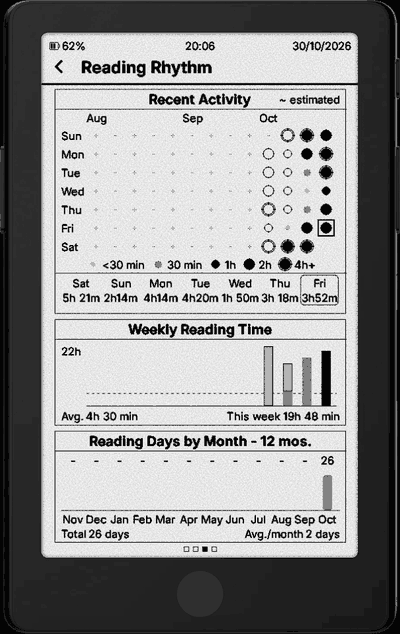<br/>
      <em>Reading Rhythm</em>
    </td>
    <td align="center">
      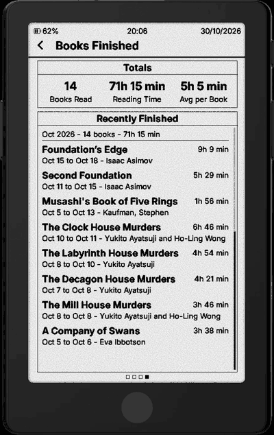<br/>
      <em>Books Finished</em>
    </td>
  </tr>
</table>

<sub>Screenshots from an X4 Pro.</sub>

---

## What this fork adds

### Reading Rhythm

How often and how much you read, at a glance:

- **Recent Activity**: a dot for each day over the last 13 weeks. Dots get bigger and darker in five steps (under 30 min, 30 min, 1h, 2h, and 4h+ with an outer ring), with a legend under the grid. Today has a square around it. Below it, the last 7 days show the time read each day.
- **Weekly Reading Time**: one bar per week for the same 13 weeks. The current week is solid, and a dashed line marks your average.
- **Reading Days by Month**: how many days you read in each of the last 12 months, plus the total and the monthly average.

### Books Finished

- **Totals**: books read, total time spent on finished books, and average time per book.
- **Recently Finished**: each finished book with its title, start → finish date, author and time spent, grouped by month.
- The list is a scroll panel with a scroll bar: swipe up/down to scroll, or move the selection with Up/Down.
- Tap a book (or select it and press Confirm) to open its **book detail** view: an **Overview** page (sessions, time, pace, dates, time of day, day of week) and a **Book Rhythm** page (reading days across the book's span, daily or weekly reading time, days read, average per day, longest streak). Back returns to the list.
- Books that dropped out of Recent Books are still found by scanning the book caches already on the SD card.

<table>
  <tr>
    <td align="center">
      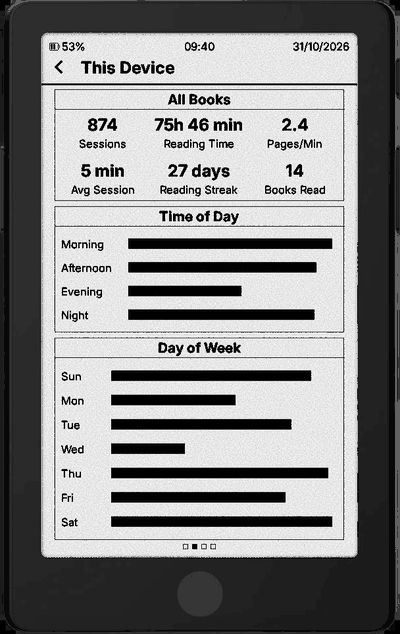<br/>
      <em>This Device (stock CrossInk)</em>
    </td>
    <td align="center">
      <br/>
      <em>→ Reading Rhythm</em>
    </td>
    <td align="center">
      <br/>
      <em>→ Books Finished</em>
    </td>
  </tr>
</table>

### Book detail

Each finished book has its own Overview and Book Rhythm pages. The same view opens from **Reading Stats** in a book's long-press menu in the Library or File Browser. Per-book reading minutes are recorded from this firmware on, in `rhythm_days.bin` next to the book's `stats_v5.bin`, which is never changed. Days before that are estimated from your real read days between the book's start and finish dates and drawn lighter. The dots use the same five steps as Reading Rhythm, and the book's first and last days have a square around them. Short books (up to 3 weeks) show daily bars; longer ones show weekly bars for up to the last 13 weeks.

<table>
  <tr>
    <td align="center">
      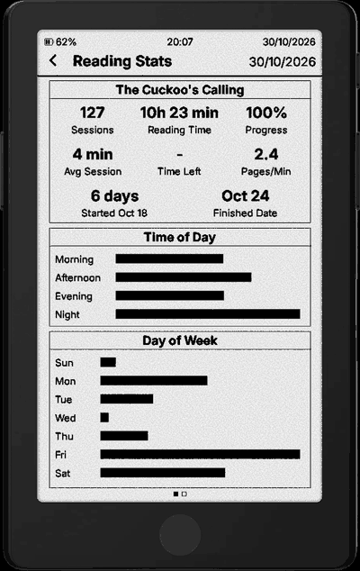<br/>
      <em>Overview</em>
    </td>
    <td align="center">
      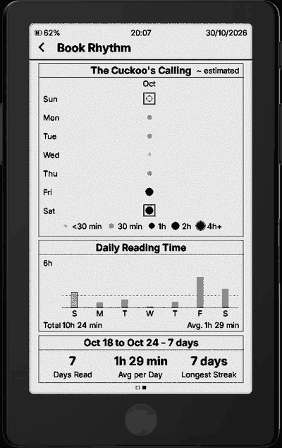<br/>
      <em>Book Rhythm (recorded days)</em>
    </td>
    <td align="center">
      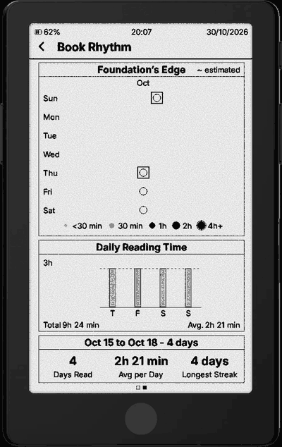<br/>
      <em>Book Rhythm (estimated days)</em>
    </td>
  </tr>
</table>

### Boot screen and version

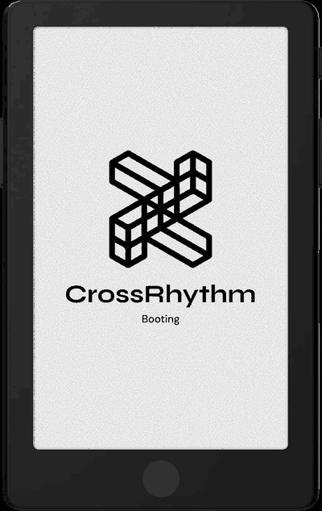

The default boot screen is replaced by the CrossRhythm image above (`src/images/boot-rhythm.bmp`, run-length encoded by `scripts/bmp_to_boot_header.py` to about 5 KB of flash). CrossInk's custom boot screen setting still takes priority when it's on. Settings › System shows the firmware as **CrossRhythm v&lt;version&gt;**.

<br clear="right"/>

### Indic books

Install the matching font and Indic text in any book renders correctly, without changing your reading font. A mostly-English library keeps its usual font; only the Indic parts switch, at the closest installed size to your reading size. Install more than one and each script is routed to its own font, so a mixed library needs no fiddling. The same font also draws Indic file names, book titles and chapter names in the file browser, Home, chapter list and reader footer.

These scripts stack or attach the consonants of a cluster to a base letter and join vowel signs to the letter they belong to; several also move part of a vowel sign in front of it. Fonts do this with shapes that have no character codes of their own, so drawing text one character at a time shows separate letters with visible viramas (್). This fork works those shapes out ahead of time with [HarfBuzz](https://harfbuzz.github.io/) and ships the result as a small `shaping.cpshape` file inside each font's folder. When the font is on the card the reader loads that file and applies it as it measures and draws a line, so conjuncts stack, vowel signs join, and reph sits where it should. The book's text itself is unchanged, so dictionary lookup, clippings and search still see real text.

Book pages on the X4 Pro, in each supported script:

<table>
  <tr>
    <td align="center">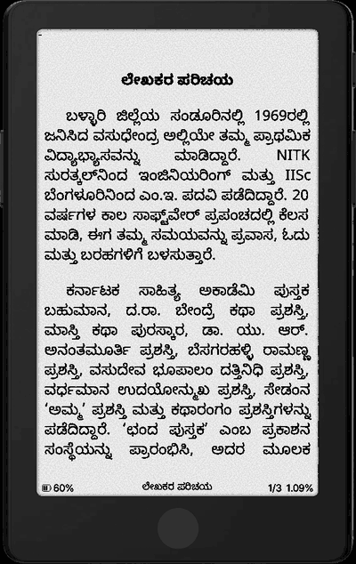<br /><sub>Kannada</sub></td>
    <td align="center">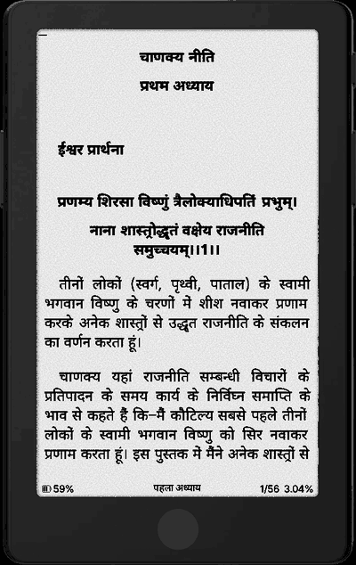<br /><sub>Hindi</sub></td>
    <td align="center">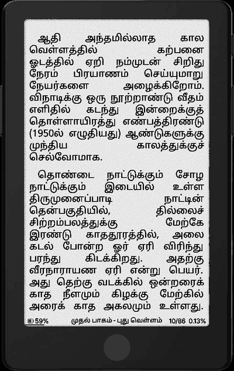<br /><sub>Tamil</sub></td>
    <td align="center">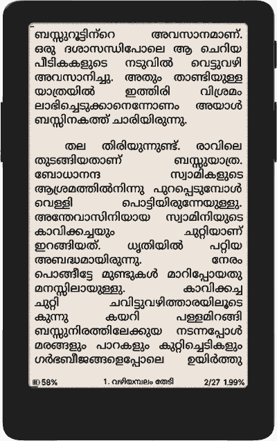<br /><sub>Malayalam</sub></td>
    <td align="center">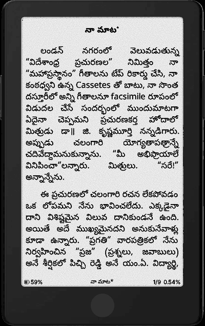<br /><sub>Telugu</sub></td>
  </tr>
</table>

The same fonts draw the rest of the interface too: file names, book titles and chapter names.

<table>
  <tr>
    <td align="center">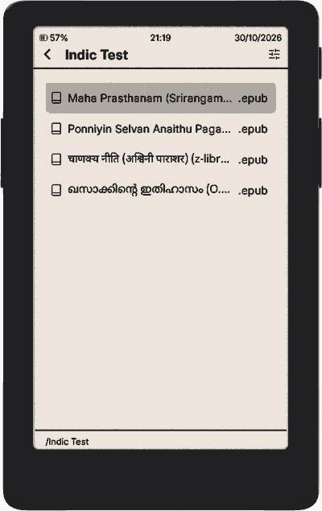<br /><sub>File browser</sub></td>
    <td align="center">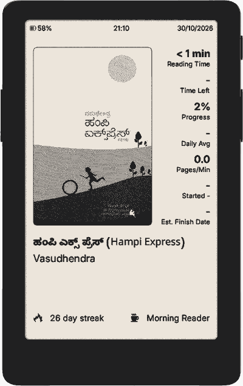<br /><sub>Home</sub></td>
    <td align="center">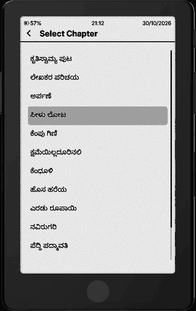<br /><sub>Chapter list</sub></td>
  </tr>
</table>

Nothing about this is built into the firmware: every script works with the same firmware, and installing a font folder is the whole setup.

| Script | Font folder to copy | Folder size (8 sizes) | Shaping file | Status |
| --- | --- | --- | --- | --- |
| Kannada | `NotoSansKannada` | 6.2 MB | 26 KB | Tested on device |
| Tamil | `NotoSansTamil` | 5.9 MB | 24 KB | Tested on device |
| Malayalam | `NotoSansMalayalam` | 5.9 MB | 43 KB | Tested on device |
| Telugu | `NotoSansTelugu` | 7.9 MB | 58 KB | Tested on device |
| Hindi, Marathi (Devanagari) | `NotoSansDevanagari` | 6.1 MB | 140 KB | Tested on device |
| Bengali | `NotoSansBengali` | not built here | 253 KB | Experimental: most conjuncts fall back to literal table rows |
| Odia | `NotoSansOriya` | not built here | 107 KB | Experimental |

Install only the scripts you read; each folder is self-contained. Firmware cost is about 6 KB of flash for all of them together, because the tables live on the SD card.

The shaping file is held in memory while its font is installed. On the X4 Pro and other ESP32-S3 readers it goes in PSRAM, where all seven together use under 1 MB of 8 MB. ESP32-C3 readers (X3, X4) have no PSRAM and too little free RAM during reading to hold one safely, so there the script still draws but its conjuncts appear as separate letters.

**Installing a font:**

1. Download the font pack from this fork's [releases](https://github.com/rosstopherkeen/CrossRhythm/releases), or build it yourself (see [Building](#building)). Either way you end up with a folder such as `NotoSansTelugu/` holding eight `NotoSansTelugu_<size>.cpfont` files and `shaping.cpshape`.
2. Copy that folder to `/.fonts/` (or `/fonts/`) on the SD card, keeping the folder name exactly as it is. The card should look like this:

   ```
   /.fonts/
     NotoSansKannada/
       NotoSansKannada_8.cpfont
       NotoSansKannada_9.cpfont
       ...
       NotoSansKannada_20.cpfont
       shaping.cpshape
     NotoSansTelugu/
       NotoSansTelugu_8.cpfont
       ...
       shaping.cpshape
   ```

   On the X4 Pro, **Home › File Transfer › USB Drive** exposes the card to your computer. You can also upload the folder from the web portal's **Fonts** page.
3. If you opened a book in one of these scripts before installing its font, open it and choose **Delete Book Cache** from the reader menu, so its pages are laid out again with the new font.

**Updating:** a font folder and its `shaping.cpshape` are generated together, so replace the whole folder when you update, never a single file. After updating fonts, use **Delete Book Cache** on a book if its pages look stale.

**What is handled beyond the basics:** word-final consonant + halant in Kannada, Tamil and Telugu (for example ಕುಮಾರ್) draws the joined final form, and Hindi letters written with a nukta (ज़, फ़, ड़) draw as one letter. Not handled: the final halant forms of ड़्, ढ़् and ऴ् in Hindi still differ slightly from a full shaper.

Copy the whole folder, including `shaping.cpshape`; without it the font draws but conjuncts come apart. Use the generated `.cpfont` files, not the `.ttf`: the shaped forms only exist in the `.cpfont` files, so a `.ttf` shows the text as separate letters. None of these fonts has an italic, so italic text in these scripts shows upright.

### Where to find them

Open **Reading Stats** the usual way. On the X4 Pro that's the frontlight panel, or the reader menu on button devices. Swipe left or press Right/Down past *This Device* (and *All Devices*, if you sync stats). The two new pages share the existing page dots, header and card layout. Weeks start on Monday by default; set **First Day of Week** in Settings › System › Device to start them on Sunday.

The pages need the device clock. On devices without one, Reading Stats keeps its single-screen layout.

### Charging animation and Life Views (X4 Pro)

A scene is a 1-bit illustration that is built up in 21 steps, one per 5%. Two settings use scenes:

<table>
  <tr>
    <td align="center">
      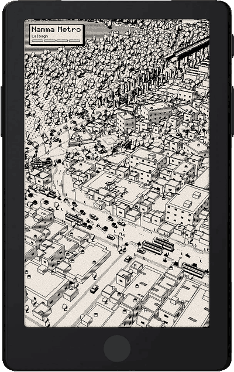<br/>
      <sub><b>Lalbagh</b></sub>
    </td>
    <td align="center">
      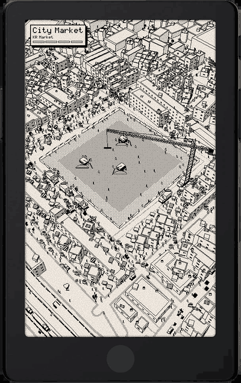<br/>
      <sub><b>KR Market</b></sub>
    </td>
    <td align="center">
      <br/>
      <sub><b>State Library</b></sub>
    </td>
    <td align="center">
      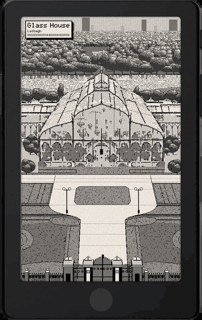<br/>
      <sub><b>Glass House</b> (built in)</sub>
    </td>
  </tr>
</table>

- **Settings › Display › Charging Animation**: while the device sleeps on the charger, the sleep screen shows the scene for the battery level, with four stops under the name filling at 25/50/75/100%. It updates within about five minutes of each 5% step, and unplugging brings back your usual sleep screen.
- **Settings › Display › Sleep Screen › Wallpaper › Life Views**: the sleep screen shows the scene for how far you are in your latest book. Pick the scene in the **Life View** row that appears under Wallpaper, or **Cycle All** to show the next scene each time the device sleeps.

**Glass House** (Lalbagh's Glass House, from bare lawns to a planted garden with a Gandaberunda topiary and a crowd of visitors) is built into the firmware and is the default for both. More scenes, such as **Lalbagh** (Namma Metro's Green line built past Lalbagh's West Gate), **KR Market** (City Market) and **State Library** (Cubbon Park's reading hall, from boxes in an empty hall to full shelves and a crowd), are single `.cpscene` files:

1. Download the `.rhythmscene` file from this fork's [releases](https://github.com/rosstopherkeen/CrossRhythm/releases).
2. Copy it to `/.scenes/` (or `/scenes/`) on the SD card. On the X4 Pro, **Home › File Transfer › USB Drive** exposes the card to your computer.
3. Open Settings: the scene now appears in both the Charging Animation and Life View lists.

If a chosen scene file is removed or damaged, the sleep screen falls back to Glass House. Scenes keep their frames on the card, so they don't use firmware space.

---

## How your data is handled

- **Existing stats are never changed.** `global_stats.bin` stays at version 3 (159 bytes) and each book's `stats_v5.bin` is only read. Stock CrossInk can still read the same card.
- **New data lives in new files only**, all versioned and saved safely (temp file, check, `.bak`, rename):
  - `daily_minutes.bin` stores minutes read per day for the last 91 days, recorded at the end of each reading session.
  - `finished_books.bin` is the Books Finished list (up to 32 books), in XPoint's file format.
  - `<book cache>/rhythm_days.bin` stores one book's minutes per day for its Book Rhythm page.
- **Reading days are real.** They come straight from CrossInk's existing reading history.
- **Earlier minutes are estimated once.** Daily minutes didn't exist before this fork. The first time you open Reading Rhythm, each book's total reading time is spread over the days you actually read it. Estimated days are drawn lighter (outlined dots, light bar segments, `~` before the value). Real minutes recorded from then on always replace the estimates.

File layouts are documented in [docs/file-formats.md](./docs/file-formats.md).

### Going back to stock CrossInk

Flash a CrossInk release. It ignores `daily_minutes.bin` and `finished_books.bin`, and all your existing stats stay readable. To clean up, delete those two files (and any `.bak` copies) from `/.crosspoint/`.

---

## Installation

1. Download `firmware-x4-pro.bin` from this fork's [releases](https://github.com/rosstopherkeen/CrossRhythm/releases), or build it yourself (see below).
2. Back up `/.crosspoint/` on your SD card.
3. Copy the `.bin` to the SD card and install it from **Settings › System › SD Card Firmware Update**.

Over-the-air updates (**Settings › Check for Updates**) check this fork's releases, not CrossInk's.

**Supported devices:** built and tested on the **Xteink X4 Pro**. The other CrossInk targets (X3/X4, X4 Classic, Sticky) build from the same code but are untested.

---

## Building

PlatformIO builds the firmware. You need **Python 3.10 or newer** and **PlatformIO 6.1.x**. PlatformIO 6.2.0 currently breaks the ESP32-C3 link step with `No module named 'SCons.Tool.FortranCommon'`.

```bash
git submodule update --init --recursive
```

```bash
pio run -e x4-pro
```

The firmware ends up at `.pio/build/x4-pro/firmware.bin`.

Run the host tests, including `test/reading_rhythm/` for the new data files and the estimate math:

```bash
cmake -S test -B build-tests && cmake --build build-tests -j 8 && ctest --test-dir build-tests --output-on-failure
```

Build the Indic font packs (needs the Python packages in `lib/EpdFont/scripts/requirements.txt`, including `uharfbuzz`):

```bash
python3 lib/EpdFont/scripts/build-sd-fonts.py --only NotoSansKannada,NotoSansTelugu,NotoSansTamil,NotoSansDevanagari,NotoSansBengali,NotoSansOriya,NotoSansMalayalam --output-dir .pio/sd-fonts
```

Each family lands in `.pio/sd-fonts/<Family>/` with its `shaping.cpshape` copied in, plus a matching `<Family>.zip` ready to attach to a release. The shaping files are committed under `lib/EpdFont/scripts/shaping/`. Regenerate one with `lib/EpdFont/scripts/gen_indic_shaping.py --script <name> <font.ttf> --golden` only when changing that script's font; the script refuses to write tables that don't match HarfBuzz, and `test/indic_shaping/` checks the firmware against it.

Simulator: `pio run -e x4-pro-simulator -t run_simulator`, with an SD card copied into `./fs_/`. The simulator has no clock, so the new pages only appear on real hardware.

The fork's code lives in `src/activities/reader/rhythm/`. The hooks into existing CrossInk code are small: recording minutes when a reading session ends, recording a book when it's marked finished, adding the two pages to the stats screen, and pointing over-the-air updates at this fork. For general CrossInk development docs, see [Getting Started](./docs/development/getting-started.md).

---

## Credits

- **[CrossInk](https://github.com/uxjulia/CrossInk)** by uxjulia, the firmware this fork is built on. For CrossInk's own features (fonts, themes, Focus Reading, button remapping, stats sync and more), see its [README](https://github.com/uxjulia/CrossInk#readme) and [crossink.dev](https://www.crossink.dev). Please support CrossInk directly via its [Ko-fi](https://ko-fi.com/Q5Q01M6S7).
- **[XPoint](https://github.com/Belphemur/XPoint)** (MIT License, Copyright (c) 2025 CrossPoint Reader organization), where the Reading Rhythm and Books Finished screens and the finished-books file format come from: `ReadingRhythmActivity`, `FinishedBooksActivity`, `FinishedBooksIndex`, and `renderReadingRhythmPage` / `renderFinishedBooksPage` from `BookStatsView.cpp`.
- **[CrossPoint Reader](https://github.com/crosspoint-reader/crosspoint-reader)**, the upstream firmware for both.
- The **[Noto Sans](https://fonts.google.com/noto)** Indic families — Devanagari, Bengali, Oriya, Tamil, Telugu, Kannada and Malayalam (all SIL Open Font License 1.1) — and **[HarfBuzz](https://harfbuzz.github.io/)**, used at build time to work out the shaping tables.
- The **Lalbagh** and **KR Market** scenes are drawn from map data © [OpenStreetMap](https://www.openstreetmap.org/copyright) contributors, available under the Open Database License (ODbL).

This is a personal fork. Issues with CrossInk itself belong in the [CrossInk repo](https://github.com/uxjulia/CrossInk); issues with the two stats pages belong [here](https://github.com/rosstopherkeen/CrossRhythm/issues).
